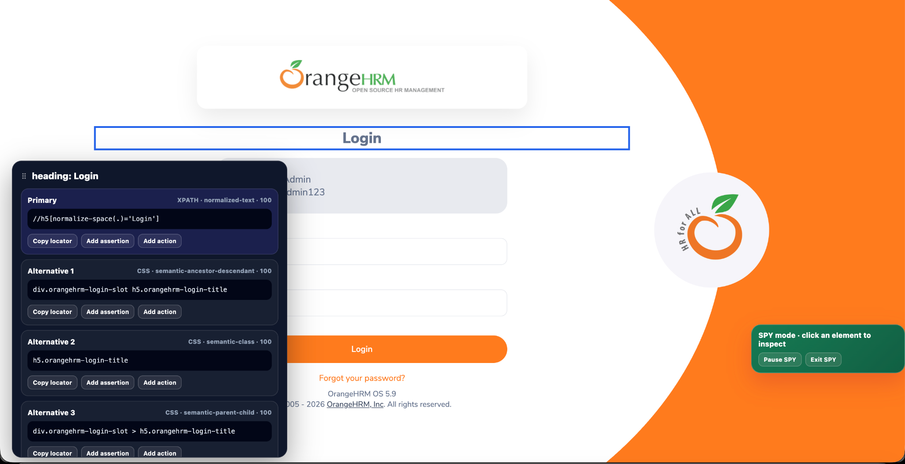

# TestFlow Recorder

> Record, inspect, validate, replay, and export web QA flows with robust locator strategies.

**TestFlow Recorder** is a Chrome extension built for QA engineers and test automation specialists who need to capture real browser interactions and turn them into reusable, reviewable test flows.

It combines recording, Object Spy / Element Inspector, assertion design, locator analysis, evidence capture, flow reordering, isolated replay, and export-ready metadata for modern automation stacks.

**Developed by aematosy**

---

## Why TestFlow Recorder

Traditional browser recorders often capture brittle locators, over-record meaningless events, or generate scripts that are difficult to maintain.

TestFlow Recorder is designed around a different goal:

> Capture user intent, preserve useful test context, and generate automation-ready test flows that can evolve into maintainable automated tests.

The extension focuses on:

- robust locator generation;
- meaningful event recording;
- assertions placed before the action they validate;
- editable and reorderable flows;
- evidence generation;
- support for modern automation frameworks;
- privacy-aware recording;
- clean replay in isolated browser sessions.

---

## Main capabilities

### Recording

Capture meaningful browser actions such as:

- click;
- type;
- select;
- right click;
- double click;
- keyboard shortcuts with functional intent;
- navigation;
- hover when it contributes to a later action;
- assertions;
- supported DOM interactions.

TestFlow avoids recording low-value noise such as simple whitespace presses or mouse movement without a functional result.

### Element Inspector / Object Spy

Inspect page elements without recording a full test flow.

The inspector can:

- identify the element under the cursor;
- generate a primary locator;
- propose alternative locators;
- inspect parent elements when needed;
- copy a locator;
- add an assertion;
- add an action;
- minimize and restore the locator panel without closing SPY mode.



### Robust locators

TestFlow evaluates multiple locator strategies and prioritizes maintainability.

Typical strategies include:

- stable IDs;
- `data-testid` and similar test attributes;
- semantic attributes;
- ARIA roles;
- accessible names;
- labels;
- placeholders;
- normalized text;
- CSS selectors;
- XPath fallbacks;
- parent/child and sibling relationships;
- iframe context;
- Shadow DOM context;
- semantic container relationships.

The recorder avoids relying on dynamic indexes whenever a more durable locator is available.

### Assertions

Assertions are inserted **before** the action they validate.

Supported assertion types depend on the target element.

Examples:

For interactive controls:

- Visible
- Clickable
- Enabled
- Disabled
- Present
- Not present

For text-bearing UI elements:

- Exact text
- Contains text
- Visible
- Present
- Not present

For checkbox/radio controls:

- Selected
- Visible
- Clickable
- Enabled
- Disabled
- Present
- Not present

### Flow editor

Recorded steps can be:

- selected individually or in groups;
- moved up or down;
- renumbered automatically;
- skipped without deleting them;
- deleted;
- assigned a different execution locator;
- enriched with assertions.

The resulting sequence always remains ordered as `1, 2, 3, 4...`.

### Replay

Flows can be replayed in an isolated browser session.

The runner supports:

- fresh execution context;
- configurable waits;
- per-step status;
- step skipping;
- progress visualization;
- execution evidence;
- downloadable execution artifacts.

### Evidence

TestFlow can capture screenshots and diagnostic context during execution.

Evidence is designed to focus on the application under test. TestFlow UI overlays are temporarily hidden before screenshots are taken.

### Privacy controls

Sensitive values can be masked using custom CSS selectors such as:

```css
[data-sensitive],[data-private]
```

This allows teams to mark application elements whose values should not appear in recorded evidence.

### Framework targets

The recorded flow is designed to support:

- **Serenity BDD Screenplay / Java**
- **Playwright / TypeScript**
- **Playwright / Python**
- **pytest-based Python automation**

The JSON flow acts as a portable intermediate representation that can be consumed or transformed into framework-specific automation.

---

## Typical workflow

1. Start recording.
2. Execute the business flow in the application.
3. Use SPY when a locator needs inspection.
4. Add assertions where business validation is required.
5. Open the Runner.
6. Review locators and assertions.
7. Reorder or skip steps if necessary.
8. Replay the test.
9. Download the JSON / report / evidence.
10. Use the recorded flow as input for your automation framework.

---

## Downloads

The official installation channel is the **Chrome Web Store**.

GitHub is used for:

- documentation;
- release notes;
- product guides;
- issue reporting;
- public release artifacts when applicable.

This repository intentionally **does not publish the TestFlow Recorder source code**.

---

## Documentation

- [User Guide](docs/USER_GUIDE.md)
- [Installation Guide](docs/INSTALLATION.md)
- [Feature Reference](docs/FEATURES.md)
- [Framework Support](docs/FRAMEWORK_SUPPORT.md)
- [Privacy](docs/PRIVACY.md)
- [Security](docs/SECURITY.md)
- [FAQ](docs/FAQ.md)
- [Support](docs/SUPPORT.md)
- [Changelog](CHANGELOG.md)

---

## Product principles

TestFlow Recorder is built around five principles:

1. **Stable automation over fast but brittle recording**
2. **User intent over raw browser noise**
3. **Readable test flows over opaque event logs**
4. **Automation portability over framework lock-in**
5. **Privacy-aware evidence over unrestricted capture**

---

## Project status

Current public release line: **3.1.5**

Primary browser: **Google Chrome**

Primary use case: **Web QA automation**

---

## Author

**Developed by aematosy**

GitHub: `https://github.com/aematosy/testflow-recorder`
