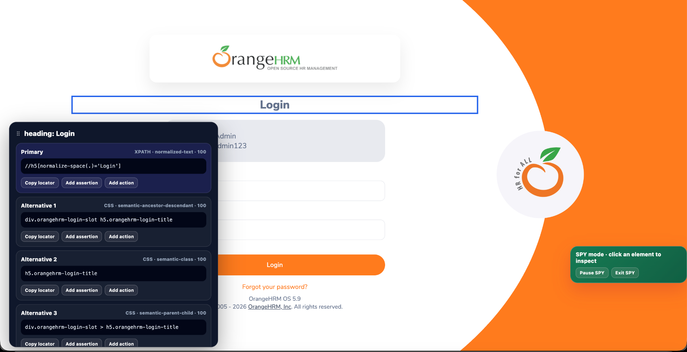

# TestFlow Recorder — User Guide

This guide explains how to use TestFlow Recorder from installation through recording, inspection, assertions, execution, evidence generation, and framework handoff.

---

## 1. Install and open TestFlow Recorder

Install TestFlow Recorder from the Chrome Web Store.

After installation:

1. Pin the extension to the Chrome toolbar.
2. Open the web application you want to test.
3. Click the TestFlow Recorder icon.
4. Choose the action you want to perform.

The extension is designed to work on user-selected web applications.

---

## 2. Main screen

The main screen provides access to the core QA workflow.

Typical actions include:

- Start recording
- Element Inspector
- Open Runner
- Load a previous recording
- Download flow JSON
- Open documentation
- Configure evidence and privacy settings

The interface can be displayed in English or Spanish.

---

## 3. Recording a flow

Start recording before interacting with the application.

TestFlow captures meaningful actions rather than every raw browser event.

Examples of useful captured actions:

- clicking a button;
- typing into a field;
- selecting an option;
- opening a menu;
- right clicking;
- double clicking;
- using a keyboard shortcut that produces an observable result;
- hovering over an element when that hover enables a later action.

### Keyboard events

TestFlow does not record every key press.

Low-value events such as a normal space character are ignored unless they are part of meaningful text entry.

Functional shortcuts such as:

`Alt + Shift + T`

may be recorded when they produce an observable result in the application.

---

## 4. Hover behavior

Hover is captured conservatively.

A hover is useful only when it contributes to a later interaction.

Example:

1. Hover over **Administration**.
2. A submenu becomes visible.
3. Click **Configuration**.

In this case the hover is part of the test intent and should be preserved.

If the mouse simply passes over an element and nothing meaningful happens afterwards, TestFlow should not keep that hover as a test step.

---

## 5. Element Inspector / SPY

Use the Element Inspector when you need to inspect an element without recording a full flow.

The inspector highlights the element under the cursor and analyzes its DOM context.



### Primary locator

The strongest candidate appears as the primary locator.

### Alternative locators

Additional candidates are displayed below the primary locator.

Use alternatives when:

- the primary locator is too broad;
- the application has dynamic attributes;
- a semantic selector is more stable;
- you want a framework-specific locator strategy.

### Inspect parent

Use **Inspect parent** when the exact node is too granular and you intentionally want the parent container.

### Minimize locators

The locator panel can be minimized without leaving SPY mode.

When minimized, SPY remains active.

Use **Show locators** from the SPY control to restore the locator panel.

---

## 6. Locator strategy

TestFlow prefers stable, human-understandable locators.

A simplified priority model is:

1. Stable test attributes
2. Stable IDs
3. ARIA role + accessible name
4. Labels and form semantics
5. Name / placeholder
6. Exact or normalized text
7. Stable CSS relationships
8. Stable XPath relationships
9. Structural fallbacks

TestFlow tries to avoid positional selectors and dynamic indexes whenever possible.

### Example

Preferred:

```text
role=button[name="Save"]
```

Better than:

```text
div:nth-child(4) > div:nth-child(2) > button
```

---

## 7. Adding assertions

Assertions should describe the state that must be true **before** the following action runs.

Example:

1. Assert **Save** button is clickable
2. Click **Save**

This is why TestFlow inserts a new assertion immediately before the action being validated.

### Assertion options depend on the element

For a normal input:

- Visible
- Clickable
- Enabled
- Disabled
- Present
- Not present

For a heading or label:

- Exact text
- Contains text
- Visible
- Present
- Not present

For checkbox/radio:

- Selected
- Visible
- Clickable
- Enabled
- Disabled
- Present
- Not present

---

## 8. Runner

The Runner is the flow review and execution workspace.

It allows you to:

- inspect every recorded action;
- review the selected locator;
- choose another locator;
- add assertions;
- skip steps;
- change waits;
- delete steps;
- reorder steps;
- execute the full flow.

### Reordering

Select one or multiple rows.

Use **Move up** or **Move down**.

TestFlow renumbers the complete sequence automatically.

Example:

Before:

```text
1
2
3
4
5
```

After moving steps:

```text
1
2
3
4
5
```

The visual order and execution order always remain aligned.

---

## 9. Execution

Use **Run in Incognito** when isolated execution is required.

Chrome controls whether an extension is allowed to run in Incognito mode.

If Incognito access is disabled, Chrome requires the user to enable it manually from the extension details page.

TestFlow cannot enable this browser permission automatically.

---

## 10. Evidence

Execution can generate screenshots and diagnostic evidence.

TestFlow hides its own overlays before taking screenshots so that the evidence represents the application under test.

Artifacts may include:

- screenshots;
- flow JSON;
- execution report;
- diagnostic metadata.

Download naming follows:

```text
testflow-report-YYMMDD-HHMMSS
```

---

## 11. Privacy

Use **Advanced privacy** to identify sensitive application elements.

Example:

```css
[data-sensitive],[data-private]
```

When possible, TestFlow masks or avoids exposing values associated with those elements in evidence.

Teams can extend this selector list according to their application conventions.

---

## 12. Export and automation frameworks

The flow JSON is the portable representation of the recording.

It can support automation generation for:

### Serenity Screenplay / Java

Typical actions map to Screenplay interactions such as:

- Click
- Enter
- SelectFromOptions
- RightClick
- MoveMouse
- Ensure

### Playwright / TypeScript

Examples:

```ts
await page.getByRole("button", { name: "Save" }).click();
await expect(locator).toBeVisible();
```

### Playwright / Python

Examples:

```python
page.get_by_role("button", name="Save").click()
expect(locator).to_be_visible()
```

### pytest

The Python Playwright output can be integrated into pytest-based automation suites.

---

## 13. Troubleshooting

### SPY detects an element but no locator is resolved

Try:

1. Inspecting the parent
2. Checking whether the application uses iframe or Shadow DOM
3. Inspecting a semantic child/parent
4. Using a manual locator only as a last resort

### An element has a dynamic ID

Prefer:

- data attributes;
- role + name;
- stable class relationships;
- label relationships;
- normalized text.

### A flow is flaky

Review:

- locator stability;
- waits;
- navigation timing;
- iframe context;
- Shadow DOM context;
- whether an assertion should be added before the action.

---

## 14. Recommended QA workflow

For maintainable automation:

1. Record the business flow.
2. Review every locator.
3. Replace weak locators.
4. Add assertions at business checkpoints.
5. Remove unnecessary actions.
6. Replay.
7. Validate evidence.
8. Export.
9. Convert the reviewed flow into framework automation.
10. Commit the resulting automation into your engineering repository.

---

## 15. Documentation and support

GitHub:

`https://github.com/aematosy/testflow-recorder`

See also:

- [Features](FEATURES.md)
- [Framework Support](FRAMEWORK_SUPPORT.md)
- [FAQ](FAQ.md)
- [Support](SUPPORT.md)

---

**Developed by aematosy**
